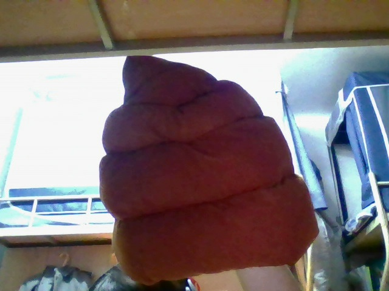
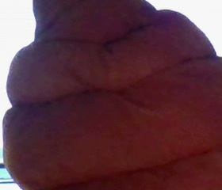
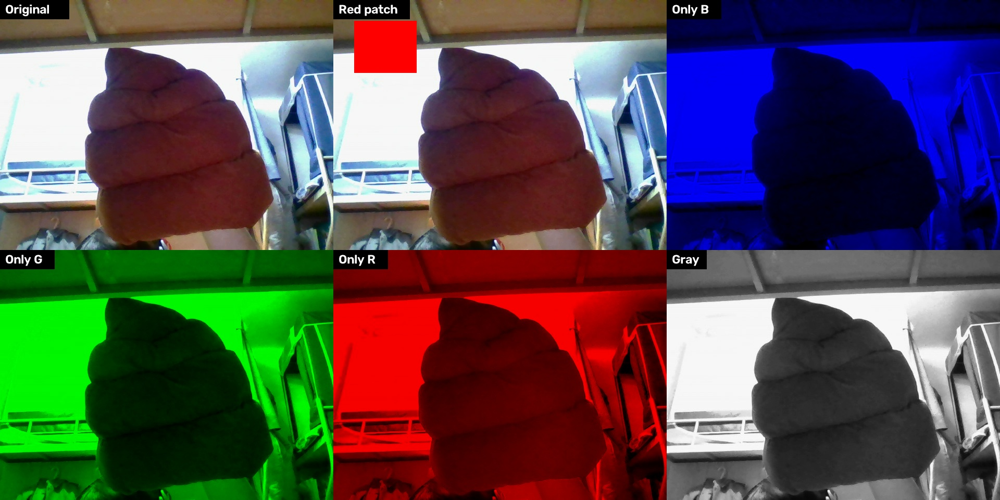
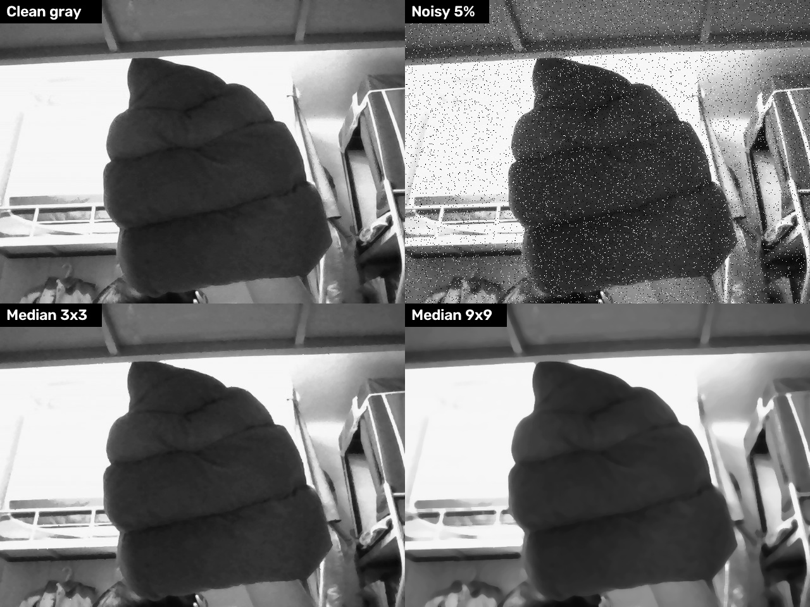
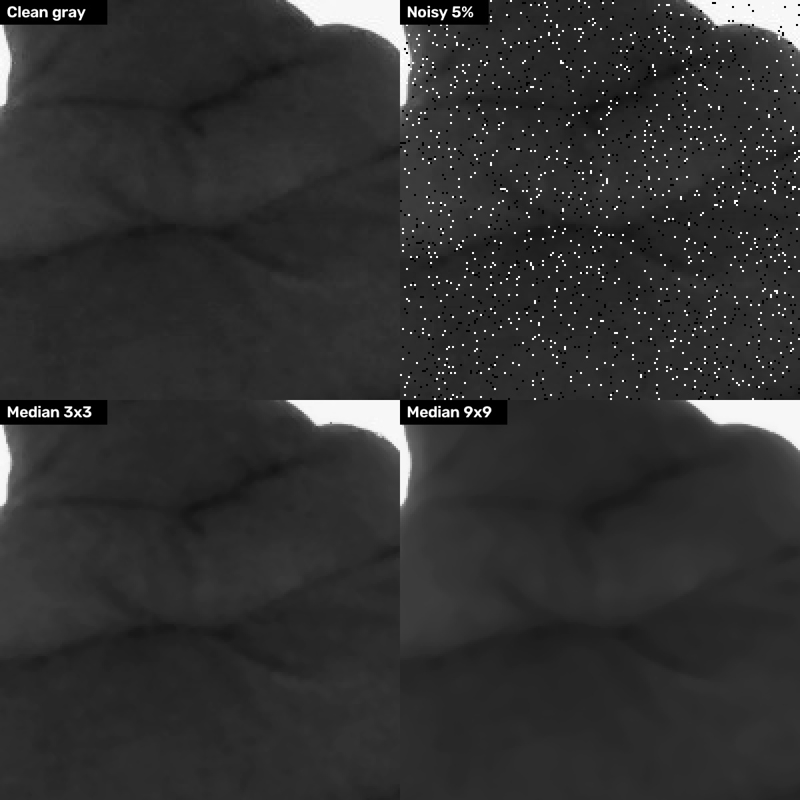
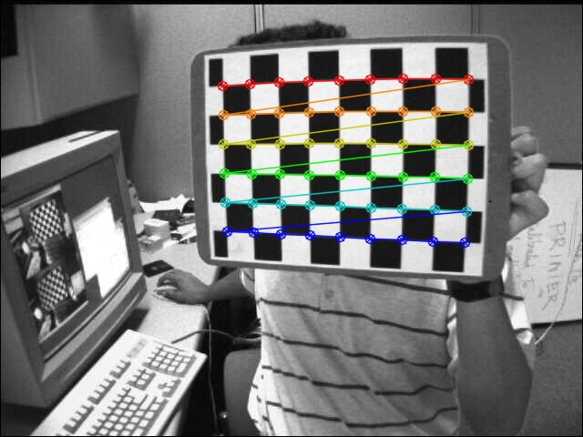
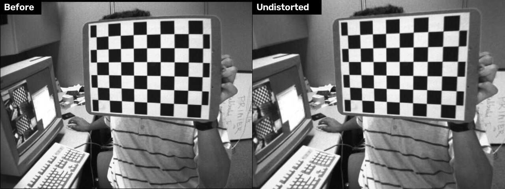

# vision — 摄像头拍照、图像处理与相机标定

机器人社团视觉组第二次任务。用电脑摄像头拍照，通过 NumPy 和 OpenCV 完成像素与通道操作、椒盐噪声与中值滤波，并用棋盘图片做相机标定。

## 环境

- 操作系统：Windows 11
- 环境管理：Anaconda（conda 26.5.3），独立环境 `vision`
- Python 3.12.13
- 依赖：numpy 2.5.4、opencv-python 5.0.0.93（`cv2.__version__` 显示 `5.0.0`），见 `requirements.txt`

创建环境并安装依赖：

```bash
conda create -n vision python=3.12 -y
conda run -n vision python -m pip install -r requirements.txt
```

> 注：`requirements.txt` 不是任务要求，是为了方便复现环境额外添加的。

所有脚本都在**仓库根目录**运行，例如：

```bash
conda run -n vision python src/array_ops.py
```

## 目录

```text
vision/
├── README.md
├── requirements.txt
├── .gitignore
├── src/        # capture.py / array_ops.py / filter_demo.py / calibrate.py
├── data/       # photo.jpg 和 calibration/ 棋盘图片
└── results/    # 处理结果、角点图、标定参数、去畸变对比
```

## 1. 拍照

用 `cv2.VideoCapture` 打开摄像头，按 `s` 保存到 `data/photo.jpg`，按 `q` 退出；退出时释放摄像头并关闭窗口，打开或读帧失败会给出提示。

```bash
conda run --live-stream -n vision python src/capture.py
```



## 2. 数组与通道操作

照片读入后是 NumPy 数组：`shape = (480, 640, 3)`，`dtype = uint8`，分别对应高、宽、通道数。

- 取样像素 `(u, v) = (320, 240)`，即 `img[240, 320]`，值为 `[26, 17, 67]`（B, G, R）。
- 裁剪区域：`x: 160–440, y: 120–360`，结果存为 `results/crop.jpg`。
- 局部改色区域：`x: 40–160, y: 40–140`，在原图副本上改为红色 `(0, 0, 255)`。



六图对比（原图、局部改色、仅 B、仅 G、仅 R、灰度）：



灰度图 `shape = (480, 640)`，比彩色图少一个通道维度；它是三个通道的加权和，不是单独取某一个通道。

**简答：OpenCV 彩色图像的三个通道按什么顺序排列？**

B、G、R（蓝、绿、红）。代码中 `img[v, u]` 返回的数组顺序就是 `[B, G, R]`。

## 3. 椒盐噪声与中值滤波

- 在灰度图副本上随机选取 5% 的像素（固定种子 `seed=42`，共 15360 个），一半设为 0（椒），一半设为 255（盐）。
- 分别用 `3×3` 和 `9×9` 核做中值滤波。

运行命令：

```bash
conda run -n vision python src/filter_demo.py
```

四图对比：



同一区域放大（`INTER_NEAREST`，×3）：



和干净灰度图的平均绝对误差（MAE）：含噪 6.38，3×3 滤波后 0.90，9×9 滤波后 2.79。

**简答：滤波核从 3×3 增大到 9×9 后，图像有什么变化？**

去噪更彻底，但边缘和纹理被明显模糊；9×9 会把细小褶皱抹平，3×3 更能保留细节，但会残留少量噪点。

## 4. 相机标定

使用 OpenCV 官方数据集中的 13 张棋盘图（`left01–left09`、`left11–left14`，数据集中没有 `left10.jpg`），全部检测成功。

- 内角点：9 列 × 6 行，共 54 个；`patternSize = (9, 6)`
- 相邻角点间距设为 1，单位为棋盘单位，`Z = 0`
- 图像分辨率：640×480（传入 `calibrateCamera` 的顺序为宽、高）
- RMS 重投影误差：**0.4087 px**

运行命令：

```bash
conda run -n vision python src/calibrate.py
```

内参矩阵：

```text
[[536.0735,   0.0000, 342.3705],
 [  0.0000, 536.0164, 235.5369],
 [  0.0000,   0.0000,   1.0000]]
```

畸变系数 `[k1, k2, p1, p2, k3]`：

```text
[-0.26509, -0.04674, 0.00183, -0.00031, 0.25231]
```

角点检测（示例）：



去畸变前后对比：



参数已保存为 `results/camera_params.npz`，包含 `camera_matrix`、`dist_coeffs` 和 `image_size`。这些参数属于数据集对应的相机，不能直接用于本机摄像头的准确校正。

**简答：内参矩阵中的 fx、fy、cx、cy 分别表示什么？**

`fx`、`fy` 是以像素为单位的焦距，分别对应 x、y 方向；`cx`、`cy` 是主点坐标，即光轴与成像平面的交点，通常接近图像中心。

## 运行命令汇总

| 脚本 | 命令 |
|---|---|
| 拍照 | `conda run --live-stream -n vision python src/capture.py` |
| 数组与通道 | `conda run -n vision python src/array_ops.py` |
| 滤波 | `conda run -n vision python src/filter_demo.py` |
| 标定 | `conda run -n vision python src/calibrate.py` |

三个处理脚本（`array_ops.py`、`filter_demo.py`、`calibrate.py`）只把结果写入 `results/`，不修改 `data/photo.jpg`；`data/photo.jpg` 只由 `capture.py` 在按 `s` 时保存，重复拍摄会覆盖它。
